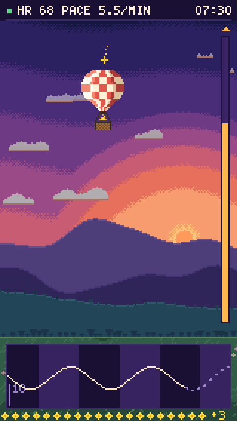
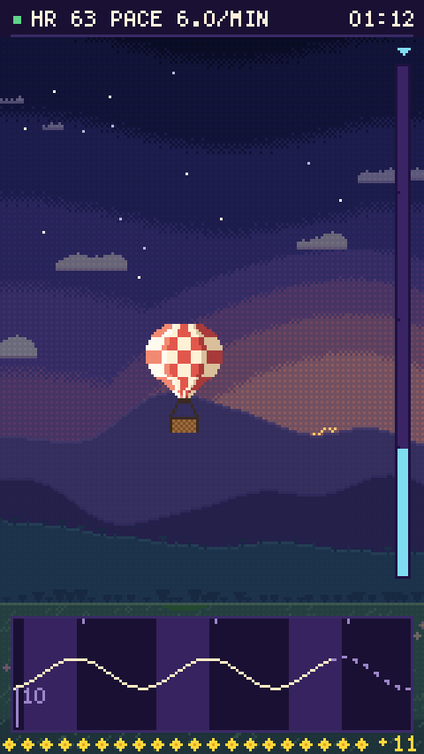
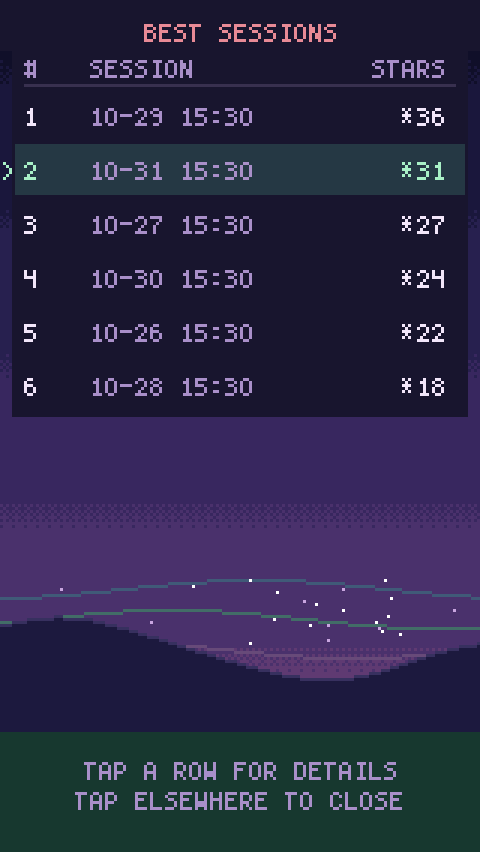
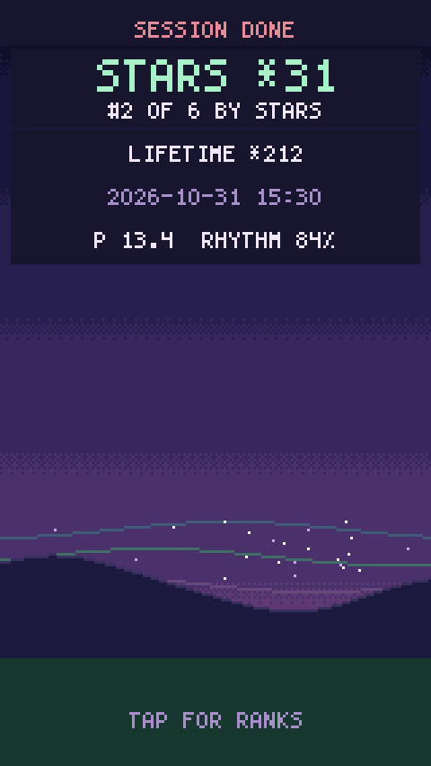

# HRV Balloon

[](https://github.com/odinokov/hrv-balloon/actions/workflows/ci.yml)
[](LICENSE)
[](#quick-start)

Android resonance-breathing and HRV-biofeedback trainer. A pixel-art hot-air balloon rises when your heart rate swings in time with your breath, read beat by beat from a Bluetooth chest strap.

Slow breathing at about six breaths a minute is a well-studied way to ease stress. The evidence, limits included, is [at the end](#why-resonance-breathing). HRV Balloon paces the breath with a visual bar and haptic cues, shows what the heart does with it, and turns the swing into lift. Fifteen minutes, one sunset, no account, no cloud, no third-party libraries beyond the Kotlin standard library.

- **Any strap with RR intervals.** Polar H10 or any Bluetooth LE strap exposing the standard Heart Rate Service with RR data.
- **Android 12+**, portrait, Kotlin, no libraries beyond the Android SDK and the Kotlin standard library. Unit tests cover the whole signal path and the scene renderer.
- **Personal project.** Not a medical device; see [the disclaimer](#not-a-medical-device).

<p align="center">
  
  
  
  
</p>
<p align="center"><sub>Frames rendered by the scene renderer at its native 160 × 284 px, scaled 3×.</sub></p>

## What a session looks like

- **Pacer.** A bar fills over the inhale and empties over the exhale, cosine-eased, 50 : 50 by default [12]. Haptic cues follow it: a short pulse marks the inhale start, a double tap the exhale start, a triple tap each star, a long buzz the end.
- **Balloon.** Lift comes from the swing: how far heart rate rises and falls with the breath. Heart rate here is beat-to-beat, 60000 / RR in ms, so 62 → 71 is a swing of 9: RR shortening from 968 to 845 ms. It is the peak-to-trough of a wave fitted over the last two breaths, which smooths out single fast or slow beats. With the default limits, below the lift threshold of 1 the balloon stays on the ground, and from the sky ceiling of 6 up it is at the top. The height is then scaled by how clean and pacer-locked the swing is. Depth without rhythm earns little.
- **Stars.** Each 10 s that the balloon stays at the ceiling drops a star (about one star per breath at the default 5.5/min). Stars come only from a live estimate, so none fall while the status line shows Settling. Stars are the score; the Ranks screen orders past sessions by them.
- **Ranks.** Tap a row to open its results card; a training session's card shows the mean rhythm (R², %).
- **Status line.** `HR 68 Pace 5.5/min` with the countdown on the right. HR is the strap's own reading; the trace and the swing use beat-to-beat HR from RR. Labels when they apply: `Settling` (window refilling), `Steady` (the swing does not follow the pacer), `Search` (resonance search), `No signal`, `Done`.
- **Trace.** The last 30 s of heart rate; light bands are inhales, dark bands exhales. The line trails real time by about five seconds, because each beat is confirmed by the next two and smoothed before it is drawn. Dim dashes bridge that stretch with a forecast, and real beats replace them as they arrive. They appear after one full breath of good signal, at the start and after a loss. The forecast is display only: the balloon and the stars use measured beats, and the dashes disappear while the signal is lost.
- **Signal loss.** Link down, no skin contact, no RR for over 4 s, a gap of over 3 s in the beats, or five rejected beats in a row: the balloon holds its height, the statistics pause, and recovery warms up again. Leaving the app pauses the cues, the statistics and the resonance search; beats received meanwhile are written to the CSV only. After a minute away the session ends.

## Quick start

Needs an Android 12+ phone with Bluetooth LE and a chest strap, worn with wet electrodes.

1. Download `hrv-balloon-v1.4.apk` from the [latest release](https://github.com/odinokov/hrv-balloon/releases/latest) and compare its MD5 or SHA-256 with the release notes. Open it; Android asks you to allow installs from your browser or file manager, and Play Protect may warn about an unknown developer. Or build it as [below](#building).
2. Open the app and allow **Nearby devices**. Tap your strap in the list. It is remembered; Settings has **Rescan** and **Forget**.
3. Wait for `Ready HR 68 5.5/min 15:00`, then tap **Start · 5.5/min** and breathe with the bar.
4. Tap the screen to show **Stop**, then confirm **End**, or let the countdown run out. The results card shows your stars, your rank and the session's mean rhythm; tap it for the Ranks table.

## Breathe gently

Slow breathing at 5–6 breaths per minute should feel comfortable. If a session feels like effort, or you get light-headed, you are most likely breathing too deeply and blowing off CO₂.

- Keep your normal resting breath volume. Do not fill or empty the lungs.
- Inhale quietly through the nose into the belly. Let the exhale leave on its own.
- Keep the breath flowing. No holds at the top or bottom.
- Dizzy or tingling: make the breaths shallower and softer, and stop if it persists. The strap reports heartbeats only, so the balloon cannot warn you about depth or CO₂.
- Short of air: the pace may be too slow for you; choose a faster rate in Settings.

## Finding your resonance rate

Settings → **Find my resonance rate (next session only)**. That session starts at your current rate and probes rates between 4.0 and 7.0 /min, nine breaths each. The first breath is dropped as the physiological transient, the next two refill the fitting window, and during the last six breaths the app scores swing × rhythm from a fit over the preceding two breaths, so breaths 2 to 9 feed the probe's median score. A signal loss or leaving the app discards the probe's scores so far, and a probe left with no score restarts. Until the search ends, each probe restarts the swing estimate after its first breath, so for about three breaths in nine the balloon holds its height and no stars fall. Rates are chosen by 1-D Bayesian optimisation (Gaussian process over the rate axis, upper-confidence-bound acquisition); the second probe steps 0.7 /min in the direction the heart-rate-to-pacer phase suggests, or faster when the phase is within ±10°. A probe starts only if it can end two minutes before the session does, which leaves room for about seven probes at 5.5 /min. The search converges after at least five probes, once the model's best rate has stayed within 0.1 /min over two consecutive probes and the fitted curve's peak stands more than 50% of the mean score above its lowest point, twice the 25% noise the model assumes for one probe. On one recorded session, scores of nine-breath probes at a fixed rate varied by 18 to 36%. The pacer then moves to the found rate and stays there for the rest of the session, with no further probes, and the result is offered on the results card and under Settings as **Resonance found: 5.3 /min → Use**. When time runs out after at least five probes without such a peak, the search ends at the 5.5 /min default [12]: the pacer moves there, the card reads NO CLEAR PEAK, and if you breathe at another rate it offers **No clear peak: 5.5 /min default → Use**. A search with fewer than five probes is saved in the history without an offer: from the third probe its card shows the model's best rate so far beside the best single probe, and before that it reports no estimate yet. Treat the result as a quick estimate. In simulations with probe noise near the assumed 25%, a curve with no peak still converged on a chance rate in about a quarter of searches. Published protocols hold each rate for about 2 minutes [1, 2, 3, 6], where the app scores six breaths, about 65 s at 5.5 /min, and the resonance rate can change between sessions, in one trial falling from 6.0 to 5.1 breaths/min over ten training sessions [2]. Repeat the search on different days, and treat differences smaller than the protocols' 0.5 /min step [1, 2, 6] as noise. The search also assumes you breathe exactly with the bar; the strap measures heartbeats only.

## How the measurement works

1. **Beats.** Heart Rate Measurement packets (0x2A37) carry RR intervals in 1/1024 s units. Cumulative RR is mapped onto the phone clock with the lowest-latency envelope over the last 60 s of arrivals, so strap-vs-phone drift is tracked and no beat leads its own arrival.
2. **Artifact filter.** RR outside 300–2000 ms, or more than 20% from the median of the centred five-beat window, is rejected. A beat is classified once two more have arrived; a trailing median would lag the steep part of large swings and reject real beats exactly when amplitude is high.
3. **Amplitude.** Each accepted RR interval used by the estimator becomes an instantaneous heart rate, 60000 / RR (ms), stamped at the interval's midpoint. The most recent two breath periods of accepted data are resampled at 4 Hz and fitted by least squares, trend and sinusoid together: HR(t) ≈ a + b·t + c·cos(2πft) + d·sin(2πft), where f is the pacer frequency. Swing P = 2·√(c² + d²), the fitted peak-to-trough. Rhythm is the share of detrended variance the sinusoid explains (R², 0–1); the phase relative to inhale start feeds the search's direction hint. The fit reruns approximately every 250 ms while the signal is usable. Fluctuations at other frequencies can lower rhythm and may also affect P over this finite window. Any heart-rate oscillation at the pacer rate counts, including spontaneous slow oscillations from the baroreflex loop near 0.1 Hz (Mayer waves), whether or not breathing drives it.
4. **Lift.** `(P − threshold) / (ceiling − threshold)`, clamped to 0–1, times a rhythm gate that is 0 below R² 0.40 and full from 0.85. The balloon follows the target with a 1 s time constant. When the swing clears the lift threshold but rhythm falls below 0.55, the status line shows Steady until rhythm passes 0.65.
5. **Forecast.** A small Kalman filter runs the swing fit's model recursively: a heart-rate level plus one wave at the pacer frequency, held as a rotating pair. Between beats the wave advances by the pacer's phase, so it stays in step through rate changes, and the level and the wave may drift slowly; each accepted beat, observed as level plus wave, corrects all three by the Kalman gain. After one full breath of good signal, the dashes carry the wave forward at the pacer's rhythm around the current level, joined to the line over 1 s and redrawn as each beat arrives. The filter restarts with the swing estimate after a signal loss or a return to the app. It assumes the next few seconds look like the last few, and it is display only.
6. **Summary.** RMSSD (ms) from consecutive accepted beats only (the chain breaks at a rejection, a signal loss or a return to the app), SDNN (ms) over accepted RR, mean HR, the share of beats rejected by the filter or received while the signal was lost, and time with a live estimate. Sessions need 2 min of valid signal to be ranked. These are during-practice values, dominated by the paced breathing, and are not comparable with resting HRV norms.

### Swing versus RMSSD

HRV is often quoted as RMSSD, the root mean square of differences between consecutive RR intervals, in ms. The balloon uses a fitted peak-to-trough heart-rate swing at the pacer frequency, a sine-fit counterpart of the peak-to-trough criterion used in resonance-frequency assessment [11]. That criterion averages each breath's maximum minus minimum heart rate. The two agree only for a clean sine wave; the conventional value usually runs higher, because the 40 : 60 pacer gives an asymmetric wave and maximum minus minimum also picks up beat-to-beat noise. Successive differences act as a high-pass filter: for an approximately sinusoidal RR trace at 6 breaths/min and a mean heart rate of about 60 beats/min, RMSSD is roughly a fifth of the RR peak-to-trough. RMSSD and SDNN are also computed in ms when enough accepted data are available and saved with the session record, though neither is shown on screen.

## Settings

| Setting | Default | Notes |
|---|---|---|
| Rate, breaths/min | 5.5 | 4.0–7.0, 0.1 steps |
| Inhale : exhale | 50 : 50 | or 40 : 60 |
| Vibration cues | on | |
| Find my resonance rate | off | one session, then resets |
| Lift threshold, HR swing in beats/min | 1 | swing below this stays grounded |
| Sky ceiling, HR swing in beats/min | 6 | swing at or above this is at the top |
| Save CSV to Download/HRV | off | per-beat file, see below |

The defaults, 1 and 6, are an easy start. Swing falls steeply with age, so these limits suit older users and fill the sky quickly for fit young ones. For a harder game, raise the sky ceiling first and the lift threshold after it, since the ceiling stays at least 5 above the threshold. Ranks compare star totals, so compare sessions played at the same limits.

Thresholds are in beats per minute, so their RR equivalent depends on heart rate (|ΔRR| ≈ |ΔHR|·RR²/60000, with RR in ms): 1–6 beats/min is about 17–100 ms of RR swing at 60 beats/min, but 9–56 ms at 80 beats/min.

Session length is fixed at 15 minutes: long enough for a resonance search, short enough to do daily.

## Data

Nothing leaves the phone.

- **History.** One line per finished session in app-private storage, shown on the Ranks screen and the per-session results card.
- **CSV** (optional). `Download/HRV/hrv_YYYYMMDD_HHMMSS.csv`, flushed after every row so a crash loses nothing. Header lines `# key=value` give `app_version`, `device_address`, `device_name`, `start`, `rate_bpm`, `inhale_fraction`, `duration`, `floor_bpm`, `ceiling_bpm`. Then:

  ```
  type,t_ms,arrival_ms,rr_ms,accepted,hr_bpm,rate_bpm,pacer_phase,p2t_bpm,phase_deg,event
  ```

  `beat` rows carry the interval, whether the filter accepted it, the pacer rate and phase at that moment and the current swing estimate. `event` rows mark `disconnect`, `reconnect`, `signal_lost`, `signal_back`, `star`, `pause` and `resume`. `rate_bpm` is breaths per minute; every other `_bpm` column is beats per minute.

## Building

Requires a JDK 17 or newer (with `javac`) and an Android SDK with `platforms;android-36` and `build-tools;36.0.0`. With your own SDK, set `ANDROID_HOME` (or `sdk.dir` in `local.properties`) and run `./gradlew`, as CI does:

```sh
./gradlew -q :core:test testDebugUnitTest    # unit tests
./gradlew -q assembleDebug        # app/build/outputs/apk/debug/app-debug.apk
./gradlew -q bundleRelease        # app/build/outputs/bundle/release/app-release.aab, for Google Play
./gradlew -q assembleSideload     # app/build/outputs/apk/sideload/app-sideload.apk, for GitHub releases
```

Release builds are unsigned unless a gitignored `keystore.properties` in the repository root names the upload key: `storeFile` (relative to `app/`), `storePassword`, `keyAlias` and `keyPassword`. The sideload APK is the release build signed with this machine's debug key; GitHub releases are signed with the maintainer's, so an APK built elsewhere cannot update them.

`./gw` is a self-contained alternative: it expects the SDK in `.sdk/` inside the repository (gitignored, with `local.properties` pointing `sdk.dir` at it), uses a JDK unpacked in `.jdk/` when there is one, and keeps every tool home inside the repository, so nothing is written to `~/.gradle` or `~/.android`.

Layout:

- `core/` (Gradle module `:core`, plain Kotlin on the JVM) signal path and session logic: packet parsing, beat timeline, artifact filter, amplitude estimator, pacer, resonance search, session engine and outcome, trace forecast, summary, CSV. It cannot use Android APIs, and its tests run without Android.
- `app/src/main/kotlin/com/hrvballoon/ble` Heart Rate Service client.
- `app/src/main/kotlin/com/hrvballoon/ui` pixel scene, HUD font, balloon view, ranks.
- `app/src/main/res/values/strings.xml` every text the app shows; a translation goes in `values-xx/strings.xml` with the same names. Strings named `scene_*` and `hud_*` are drawn in the pixel font, which has only A–Z, digits, space and `# . - % : > / + * ^`; a unit test rejects any other character.
- `scripts/make_icon.py` generates the adaptive launcher icon from a pixel map.

The README frames are rendered by the scene itself:

```sh
mkdir -p build/shots && SCENE_DUMP_DIR="$PWD/build/shots" ./gradlew -q testDebugUnitTest --tests '*ScreenshotDump*'
python3 scripts/ppm2png.py 3 build/shots docs/screenshots
```

## Before and after

The app reads the heart only. If you have a blood-pressure cuff, the Kérdö vegetative index gives a crude autonomic reading that is easy to take seated and at rest, a few minutes before and a few minutes after a session [8]:

```
VI = 100 × (1 − diastolic pressure / pulse)
```

Diastolic pressure in mm Hg, pulse in beats per minute. Positive values are read as sympathetic predominance, negative values as parasympathetic predominance, zero as balance. Caveats: the index follows heart rate far more than diastolic pressure; it behaves reasonably in healthy and athletic people; and it misleads in hypertension, where a high diastolic pressure reads as vagal dominance ([overview](https://ru.wikipedia.org/wiki/Индекс_Кердо), in Russian). Measure after at least 5 minutes seated, on the same arm, as the mean of two readings, at the same time of day. A single blood-pressure reading can vary by several mm Hg, enough to move the index by several points. A trend across weeks of paired readings carries far more weight than any single pair.

## Why resonance breathing

Heart rate usually rises during inhalation and falls during exhalation. This respiratory sinus arrhythmia partly reflects vagal modulation of the sinoatrial node. Breathing also moves blood pressure; stretch receptors in the carotid sinuses and aortic arch signal the brainstem, and the baroreflex adjusts heart rate and vascular tone to stabilise it. Near the cardiovascular system's resonance frequency, around 0.1 Hz, breathing amplifies these baroreflex-related heart-rate oscillations, and heart rate variability (HRV) rises. Individual resonance rates are usually assessed between 4.5 and 7.0 breaths per minute [3, 6].

What the trials show:

- **Lehrer et al. 2020**, a meta-analysis of 58 randomised controlled studies. HRV biofeedback showed a small-to-moderate benefit, comparable to other effective treatments, and larger against inactive than active control conditions. <mark>Effects were largest for anxiety, depression, anger and athletic or artistic performance, and smallest for PTSD, sleep and quality of life</mark>, each resting on few studies [9]. Its lead author co-developed the standard protocol, and blinding is hard in biofeedback trials, where participants see their own feedback.
- **Lehrer et al. 2003**, 54 healthy adults. Ten biofeedback sessions raised resting baroreflex gain [1].
- **Lin et al. 2012**, 43 college students with prehypertension, randomised to resonance biofeedback, paced breathing at 6/min without feedback, or a control group that sat breathing normally. Both breathing groups had ten 20-minute laboratory sessions over five weeks and practised at home for 20 minutes twice a day. <mark>With biofeedback, mean systolic pressure fell from 131.7 to 118.9 mm Hg</mark> and baroreflex sensitivity rose from 7.0 to 15.8 ms/mm Hg; paced breathing at 6/min gave smaller gains, 131.3 to 123.6 mm Hg and 7.8 to 11.0 ms/mm Hg. The blood-pressure drop held at three months while practice continued at 20 minutes a day [2].
- **Lin, Tai and Fan 2014**, 47 healthy college students, each breathing four patterns in counterbalanced order: 6 or 5.5 breaths/min, with inhale to exhale 5 : 5 or 4 : 6. 5.5 breaths/min at 5 : 5 gave higher SDNN and low-frequency power than the other three patterns, and all four felt more relaxing than spontaneous breathing. HRV was measured during the breathing, in a single session. The app's defaults, 5.5 breaths/min with equal inhale and exhale, follow this result [12].
- **Steffen et al. 2017**, 95 students randomised to breathing at their resonance frequency, one breath per minute faster, or quiet sitting. <mark>After fifteen minutes at resonance, positive mood was higher than in both other groups, and systolic pressure during a subsequent mental stressor and recovery was lower than with quiet sitting.</mark> Both effects were measured in a single laboratory session [3].
- **Szulczewski 2019**, 16 participants practising six breaths per minute for 10 minutes daily over seven days. End-tidal CO₂ initially fell, a sign of over-breathing. The fall shrank with practice, while reported hyperventilation symptoms persisted [4].
- **Minjoz et al. 2026**, 47 healthy adults, genuine versus sham biofeedback, three five-minute sessions daily for 24 days. <mark>Genuine biofeedback improved positive affect and reduced depressive symptoms more than sham.</mark> HRV and electrodermal activity, at rest, under mental load and in recovery, showed no detectable difference between groups. In exploratory analyses, the size of the breathing-driven HRV swing during practice predicted psychological benefit poorly. Participants were healthy, so the trial does not address clinical depression [5].
- **Sumińska et al. 2026**, 88 participants randomised to individualised resonance breathing, a fixed six breaths per minute, or a waitlist for four weeks. <mark>Both breathing groups reduced self-reported stress, anxiety and depressive symptoms relative to the waitlist</mark>, with no significant difference between them, and resting HRV showed no training effect [6].

A high HRV reading during practice reflects the breathing of that moment. Evidence of lasting autonomic change has to come from resting measurements taken over weeks. Slow breathing also moves respiration-driven oscillations into the low-frequency band, which complicates spectral HRV measures taken during or near practice [1].

On hardware: the Polar H10 agrees closely with ECG for RR intervals at rest and during exercise [7], and its coin-cell battery is rated at about 400 hours [10].

1. Lehrer PM, Vaschillo E, Vaschillo B, et al. Heart rate variability biofeedback increases baroreflex gain and peak expiratory flow. *Psychosom Med.* 2003;65(5):796–805. [doi:10.1097/01.psy.0000089200.81962.19](https://doi.org/10.1097/01.psy.0000089200.81962.19)
2. Lin G, Xiang Q, Fu X, et al. Heart rate variability biofeedback decreases blood pressure in prehypertensive subjects by improving autonomic function and baroreflex. *J Altern Complement Med.* 2012;18(2):143–152. [doi:10.1089/acm.2010.0607](https://doi.org/10.1089/acm.2010.0607)
3. Steffen PR, Austin T, DeBarros A, Brown T. The impact of resonance frequency breathing on measures of heart rate variability, blood pressure, and mood. *Front Public Health.* 2017;5:222. [doi:10.3389/fpubh.2017.00222](https://doi.org/10.3389/fpubh.2017.00222)
4. Szulczewski MT. Training of paced breathing at 0.1 Hz improves CO2 homeostasis and relaxation during a paced breathing task. *PLoS ONE.* 2019;14(6):e0218550. [doi:10.1371/journal.pone.0218550](https://doi.org/10.1371/journal.pone.0218550)
5. Minjoz S, Jeanne R, Pellissier S, Hot P. Psychophysiological effects of heart rate variability biofeedback versus sham biofeedback: a randomized controlled trial. *Biol Psychol.* 2026;206:109254. [doi:10.1016/j.biopsycho.2026.109254](https://doi.org/10.1016/j.biopsycho.2026.109254)
6. Sumińska S, Rynkiewicz A, Szulczewski M. Resonance frequency versus fixed 0.1 Hz breathing in HRV biofeedback: a four-week randomized comparison. *Sci Rep.* 2026;16:22630. [doi:10.1038/s41598-026-53333-6](https://doi.org/10.1038/s41598-026-53333-6)
7. Schaffarczyk M, Rogers B, Reer R, Gronwald T. Validity of the Polar H10 sensor for heart rate variability analysis during resting state and incremental exercise in recreational men and women. *Sensors.* 2022;22(17):6536. [doi:10.3390/s22176536](https://doi.org/10.3390/s22176536)
8. Kérdö I. Ein aus Daten der Blutzirkulation kalkulierter Index zur Beurteilung der vegetativen Tonuslage. *Acta Neuroveg (Wien).* 1966;29(2):250–268. [doi:10.1007/BF01269900](https://doi.org/10.1007/BF01269900)
9. Lehrer P, Kaur K, Sharma A, et al. Heart rate variability biofeedback improves emotional and physical health and performance: a systematic review and meta analysis. *Appl Psychophysiol Biofeedback.* 2020;45(3):109–129. [doi:10.1007/s10484-020-09466-z](https://doi.org/10.1007/s10484-020-09466-z)
10. Polar Electro. Polar H10 heart rate sensor user manual: technical specifications. Accessed 1 Nov 2026. https://support.polar.com/e_manuals/h10-heart-rate-sensor/polar-h10-user-manual-english/technical-specifications.htm
11. Shaffer F, Meehan ZM. A practical guide to resonance frequency assessment for heart rate variability biofeedback. *Front Neurosci.* 2020;14:570400. [doi:10.3389/fnins.2020.570400](https://doi.org/10.3389/fnins.2020.570400)
12. Lin IM, Tai LY, Fan SY. Breathing at a rate of 5.5 breaths per minute with equal inhalation-to-exhalation ratio increases heart rate variability. *Int J Psychophysiol.* 2014;91(3):206–211. [doi:10.1016/j.ijpsycho.2013.12.006](https://doi.org/10.1016/j.ijpsycho.2013.12.006)

## Not a medical device

HRV Balloon is for breathing practice and general wellness interest. The swing needs a regular sinus rhythm and intact vagal control of the heart. With atrial fibrillation, frequent ectopic beats, a pacemaker-driven rhythm, a heart transplant or autonomic neuropathy (for example from long-standing diabetes) it is absent or meaningless, and irregular rhythms mostly show as No signal. It does not diagnose, treat, cure, mitigate or prevent any disease or condition, and it is no substitute for medical advice. Talk to a clinician before starting a breathing programme if you have a heart, lung or anxiety condition, or if practice ever brings on symptoms.

## License

[MIT](LICENSE).
