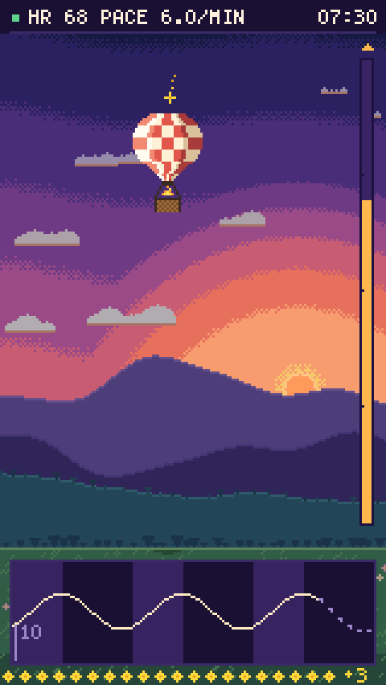
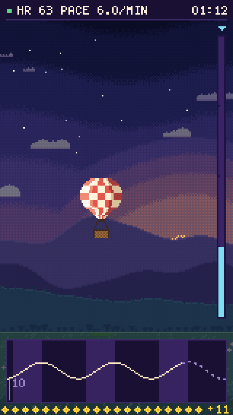
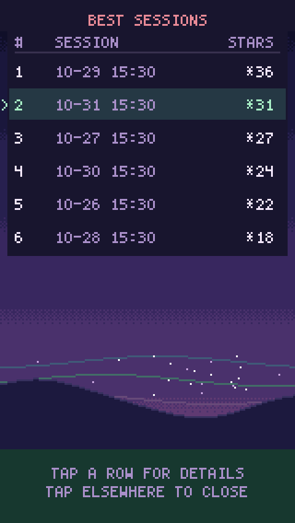
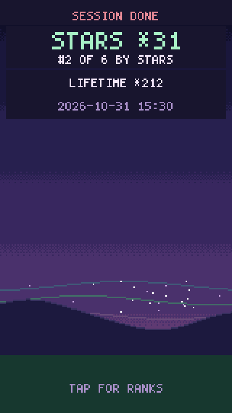

# HRV Balloon

[](https://github.com/odinokov/hrv-balloon/actions/workflows/ci.yml)
[](LICENSE)
[](#quick-start)

Android resonance-breathing and HRV-biofeedback trainer. A pixel-art hot-air balloon rises when your heart rate swings in time with your breath, read beat by beat from a Bluetooth chest strap.

Breathe six times a minute and your nervous system handles stress better. That is the premise; the evidence, limits included, is [at the end](#why-resonance-breathing). HRV Balloon paces the breath, shows what the heart does with it, and turns the swing into lift. Fifteen minutes, one sunset, no account, no cloud, no third-party code.

- **Any strap with RR intervals.** Polar H10 or any Bluetooth LE strap exposing the standard Heart Rate Service with RR data.
- **Android 12+**, portrait, Kotlin, no dependencies beyond the Android SDK. Unit tests cover the whole signal path and the scene renderer.
- **Personal project.** Not a medical device; see [the disclaimer](#not-a-medical-device).

<p align="center">
  
  
  
  
</p>
<p align="center"><sub>Frames rendered by the scene renderer at its native 160 × 284 px, scaled 3×.</sub></p>

## What a session looks like

- **Pacer.** A bar fills over the inhale and empties over the exhale, cosine-eased, 40 : 60 by default. A short vibration marks the inhale start, a double tap the exhale start, a long buzz the end.
- **Balloon.** Lift comes from how far heart rate swings within each breath, peak minus trough, in beats per minute: a breath from 62 to 71 is a swing of 9. Below the lift threshold of 3 the balloon stays on the ground; from the sky ceiling of 9 up it is at the top. The height is then scaled by how clean and pacer-locked the swing is. Depth without rhythm earns little.
- **Stars.** Every breath the balloon spends touching the ceiling drops a star. Stars are the score; the Ranks screen orders past sessions by them.
- **Status line.** `HR 68 Pace 6.0/min` with the countdown on the right. Labels when they apply: `Settling` (window refilling), `Search` (resonance search), `No signal`, `Done`.
- **Trace.** The last 30 s of heart rate; light bands are inhales, dark bands exhales. The line trails real time by about five seconds, because each beat is confirmed by the next two and smoothed before it is drawn. Dim dashes bridge that stretch with a forecast, and real beats replace them as they arrive. The forecast is display only: the balloon and the stars use measured beats, and the dashes disappear while the signal is lost.
- **Signal loss.** Link down, no skin contact, no RR for over 4 s, or five rejected beats in a row: the balloon holds its height, the statistics pause, and recovery warms up again. Leaving the app pauses statistics and cues; after a minute away the session ends.

## Quick start

Needs an Android 12+ phone with Bluetooth LE and a chest strap, worn with wet electrodes.

1. Download `hrv-balloon-v1.1.apk` from the [latest release](https://github.com/odinokov/hrv-balloon/releases/latest) and compare its MD5 or SHA-256 with the release notes. Open it; Android warns because the build is debug-signed. Or build it as [below](#building).
2. Open the app and allow **Nearby devices**. Tap your strap in the list. It is remembered; Settings has **Rescan** and **Forget**.
3. Wait for `Ready HR 68 6.0/min 15:00`, then tap **Start · 6.0/min** and breathe with the bar.
4. Tap **Stop** or let the countdown run out. The results card opens; tap it for the Ranks table.

## Finding your resonance rate

Settings → **Find my resonance rate (next session only)**. That session probes breathing rates between 4.0 and 7.0 /min, about five breaths each: one breath for the physiological transient, two to refill the measurement window, two measured. Each probe scores mean swing × mean rhythm. Rates are chosen by 1-D Bayesian optimisation (Gaussian process over the rate axis, upper-confidence-bound acquisition); the second probe steps 0.7 /min in the direction the heart-rate-to-pacer phase suggests. The search has converged after at least five probes once the model's best rate has stopped moving across two consecutive probes. The result is offered on the results card and under Settings as **Resonance found: 5.3 /min → Use**. An unfinished search records its best probe, never the rate it started from.

## How the measurement works

1. **Beats.** Heart Rate Measurement packets (0x2A37) carry RR intervals in 1/1024 s units. Cumulative RR is mapped onto the phone clock with the lowest-latency envelope over the last 60 s of arrivals, so strap-vs-phone drift is tracked and no beat leads its own arrival.
2. **Artifact filter.** RR outside 300–2000 ms, or more than 20% from the median of the centred five-beat window, is rejected. A beat is classified once two more have arrived; a trailing median would lag the steep part of large swings and reject real beats exactly when amplitude is high.
3. **Amplitude.** Beat-to-beat heart rate, midpoint-stamped, is resampled at 4 Hz over two breath periods and fitted jointly to a linear trend plus a sinusoid at the pacer frequency. The swing `P` is twice the sinusoid's amplitude; `rhythm` is the share of detrended variance the sinusoid explains (R², 0–1); the phase relative to inhale start feeds the search's direction hint.
4. **Lift.** `(P − threshold) / (ceiling − threshold)`, clamped to 0–1, times a rhythm gate that is 0 below R² 0.40 and full from 0.85. The balloon follows the target with a 1 s time constant.
5. **Forecast.** A Kalman filter tracks a heart-rate level plus one wave locked to the pacer cycle, stepped by pacer phase so it stays in step through rate changes, and is updated with every accepted beat. Its projection fills the trace from the line's end to the edge, joined to the line over 1 s.
6. **Summary.** RMSSD from consecutive accepted beats only (the chain breaks at a rejection or signal loss), SDNN over accepted RR, mean HR, rejected share, and time with a live estimate. Sessions need 2 min of valid signal to be ranked.

## Settings

| Setting | Default | Notes |
|---|---|---|
| Rate, breaths/min | 6.0 | 0.1 steps |
| Inhale : exhale | 40 : 60 | or 50 : 50 |
| Vibration cues | on | |
| Find my resonance rate | off | one session, then resets |
| Lift threshold, HR swing in beats/min | 3 | swing below this stays grounded |
| Sky ceiling, HR swing in beats/min | 9 | swing at or above this is at the top |
| Save CSV to Download/HRV | off | per-beat file, see below |

Session length is fixed at 15 minutes: long enough for a resonance search, short enough to do daily.

## Data

Nothing leaves the phone.

- **History.** One line per finished session in app-private storage, shown on the Ranks screen and the per-session results card.
- **CSV** (optional). `Download/HRV/hrv_YYYYMMDD_HHMMSS.csv`, flushed after every row so a crash loses nothing. Header lines `# key=value` give `app_version`, `device_address`, `device_name`, `start`, `rate_bpm`, `inhale_fraction`, `duration`, `floor_bpm`, `ceiling_bpm`. Then:

  ```
  type,t_ms,arrival_ms,rr_ms,accepted,hr_bpm,rate_bpm,pacer_phase,p2t_bpm,phase_deg,event
  ```

  `beat` rows carry the interval, whether the filter accepted it, the pacer rate and phase at that moment and the current swing estimate. `event` rows mark `disconnect`, `reconnect`, `signal_lost`, `signal_back`, `star`, `pause` and `resume`. `rate_bpm` is breaths per minute; every other `_bpm` column is beats per minute.

## Building

Requires JDK 17 or newer and an Android SDK with `platforms;android-34` and `build-tools;34.0.0`. The SDK lives inside the repository at `.sdk/` (gitignored) and `local.properties` points `sdk.dir` at it. The `./gw` wrapper runs Gradle with every tool home inside the repository, so nothing is written to `~/.gradle` or `~/.android`.

```sh
./gw -q testDebugUnitTest    # unit tests
./gw -q assembleDebug        # app/build/outputs/apk/debug/app-debug.apk
```

Layout:

- `app/src/main/kotlin/com/hrvballoon/core` pure-Kotlin signal path: packet parsing, beat timeline, artifact filter, amplitude estimator, pacer, resonance search, session engine, trace forecast, summary, CSV. Unit-tested without Android.
- `app/src/main/kotlin/com/hrvballoon/ble` Heart Rate Service client.
- `app/src/main/kotlin/com/hrvballoon/ui` pixel scene, HUD font, balloon view, ranks.
- `scripts/make_icon.py` generates the adaptive launcher icon from a pixel map.

The README frames are rendered by the scene itself:

```sh
mkdir -p build/shots && SCENE_DUMP_DIR="$PWD/build/shots" ./gw -q testDebugUnitTest --tests '*ScreenshotDump*'
python3 scripts/ppm2png.py 3 build/shots docs/screenshots
```

## Breathe gently

Slow breathing at 5–6 breaths per minute should feel comfortable. If a session feels like effort, or you get light-headed, you are breathing too deeply and blowing off CO₂.

- Keep your normal resting breath volume. Do not fill or empty the lungs.
- Inhale quietly through the nose into the belly. Let the exhale leave on its own.
- Keep the breath flowing. No holds at the top or bottom.
- Dizzy or tingling: make the breaths shallower and softer, and stop if it persists. The strap reports heartbeats only, so the balloon cannot warn you about depth or CO₂.

## Before and after

The app reads the heart only. If you have a blood-pressure cuff, the Kérdö vegetative index gives a crude autonomic reading that is easy to take seated and at rest, a few minutes before and a few minutes after a session [8]:

```
VI = 100 × (1 − diastolic pressure / pulse)
```

Diastolic pressure in mm Hg, pulse in beats per minute. Positive values are read as sympathetic predominance, negative values as parasympathetic predominance, zero as balance. Resonance breathing usually lowers the pulse for a while, so expect a dip after a session. Caveats: the index follows heart rate far more than diastolic pressure; it behaves reasonably in healthy and athletic people; and it misleads in hypertension, where a high diastolic pressure reads as vagal dominance ([overview](https://ru.wikipedia.org/wiki/Индекс_Кердо), in Russian). A trend across weeks of paired readings carries far more weight than any single pair.

## Why resonance breathing

Heart rate usually rises during inhalation and falls during exhalation. This respiratory sinus arrhythmia partly reflects vagal modulation of the sinoatrial node. Breathing also moves blood pressure; stretch receptors in the carotid sinuses and aortic arch signal the brainstem, and the baroreflex adjusts heart rate and vascular tone to stabilise it. Near the cardiovascular system's resonance frequency, around 0.1 Hz, breathing amplifies these baroreflex-related heart-rate oscillations, and heart rate variability (HRV) rises. Individual resonance rates are usually assessed between 4.5 and 7.0 breaths per minute [3, 6].

What the trials show:

- **Lehrer et al. 2020**, a meta-analysis of 58 randomised controlled studies. HRV biofeedback showed a small-to-moderate benefit, comparable to other effective treatments, and larger against inactive than active control conditions. <mark>Effects were largest for anxiety, depression, anger and athletic or artistic performance, and smallest for PTSD, sleep and quality of life</mark>, each resting on few studies [9].
- **Lehrer et al. 2003**, 54 healthy adults. Ten biofeedback sessions raised resting baroreflex gain [1].
- **Lin et al. 2012**, 43 college students with prehypertension, randomised to resonance biofeedback, paced breathing at 6/min without feedback, or a control group that sat breathing normally. Both breathing groups had ten 20-minute laboratory sessions over five weeks and practised at home for 20 minutes twice a day. <mark>With biofeedback, mean systolic pressure fell from 131.7 to 118.9 mm Hg</mark> and baroreflex sensitivity rose from 7.0 to 15.8 ms/mm Hg; paced breathing at 6/min gave smaller gains, 131.3 to 123.6 mm Hg and 7.8 to 11.0 ms/mm Hg. The blood-pressure drop held at three months while practice continued at 20 minutes a day [2].
- **Steffen et al. 2017**, 95 students randomised to breathing at their resonance frequency, one breath per minute faster, or quiet sitting. <mark>After fifteen minutes at resonance, positive mood was higher than in both other groups, and systolic pressure during a subsequent mental stressor and recovery was lower than with quiet sitting.</mark> Both effects were measured in a single laboratory session [3].
- **Szulczewski 2019**, 16 participants practising six breaths per minute for 10 minutes daily over seven days. End-tidal CO₂ initially fell, a sign of over-breathing. The fall shrank with practice, while reported hyperventilation symptoms persisted [4].
- **Minjoz et al. 2026**, 47 healthy adults, genuine versus sham biofeedback, three five-minute sessions daily for 24 days. <mark>Genuine biofeedback improved positive affect and reduced depressive symptoms more than sham.</mark> HRV and electrodermal activity, at rest, under mental load and in recovery, showed no detectable difference between groups. In exploratory analyses, the size of the breathing-driven HRV swing during practice predicted psychological benefit poorly. Participants were healthy, so the trial does not address clinical depression [5].
- **Sumińska et al. 2026**, 88 participants randomised to individualised resonance breathing, a fixed six breaths per minute, or a waitlist for four weeks. <mark>Both breathing groups reduced self-reported stress, anxiety and depressive symptoms relative to the waitlist</mark>, with no significant difference between them, and resting HRV showed no training effect [6].

A high HRV reading during practice reflects the breathing of that moment. Evidence of lasting autonomic change has to come from resting measurements taken over weeks. Slow breathing also moves respiration-driven oscillations into the low-frequency band, which complicates spectral HRV measures taken during or near practice [1].

On hardware: the Polar H10 agrees closely with ECG for RR intervals at rest and during exercise [7], and its coin-cell battery is rated at about 400 hours [10].

1. Lehrer PM, Vaschillo E, Vaschillo B, et al. Heart rate variability biofeedback increases baroreflex gain and peak expiratory flow. *Psychosom Med.* 2003;65(5):796–805. [doi:10.1097/01.psy.0000089200.81962.19](https://doi.org/10.1097/01.psy.0000089200.81962.19)
2. Lin G, Xiang Q, Fu X, et al. Heart rate variability biofeedback decreases blood pressure in prehypertensive subjects by improving autonomic function and baroreflex. *J Altern Complement Med.* 2012;18(2):143–152. [doi:10.1089/acm.2010.0607](https://doi.org/10.1089/acm.2010.0607)
3. Steffen PR, Austin T, DeBarros A, Brown T. The impact of resonance frequency breathing on measures of heart rate variability, blood pressure, and mood. *Front Public Health.* 2017;5:222. [doi:10.3389/fpubh.2017.00222](https://doi.org/10.3389/fpubh.2017.00222)
4. Szulczewski MT. Training of paced breathing at 0.1 Hz improves CO2 homeostasis and relaxation during a paced breathing task. *PLoS ONE.* 2019;14(6):e0218550. [doi:10.1371/journal.pone.0218550](https://doi.org/10.1371/journal.pone.0218550)
5. Minjoz S, Jeanne R, Pellissier S, Hot P. Psychophysiological effects of heart rate variability biofeedback versus sham biofeedback: a randomized controlled trial. *Biol Psychol.* 2026;206:109254. [doi:10.1016/j.biopsycho.2026.109254](https://doi.org/10.1016/j.biopsycho.2026.109254)
6. Sumińska S, Rynkiewicz A, Szulczewski M. Resonance frequency versus fixed 0.1 Hz breathing in HRV biofeedback: a four-week randomized comparison. *Sci Rep.* 2026;16:22630. [doi:10.1038/s41598-026-53333-6](https://doi.org/10.1038/s41598-026-53333-6)
7. Schaffarczyk M, Rogers B, Reer R, Gronwald T. Validity of the Polar H10 sensor for heart rate variability analysis during resting state and incremental exercise in recreational men and women. *Sensors.* 2022;22(17):6536. [doi:10.3390/s22176536](https://doi.org/10.3390/s22176536)
8. Kérdö I. Ein aus Daten der Blutzirkulation kalkulierter Index zur Beurteilung der vegetativen Tonuslage. *Acta Neuroveg (Wien).* 1966;29(2):250–268. [doi:10.1007/BF01269900](https://doi.org/10.1007/BF01269900)
9. Lehrer P, Kaur K, Sharma A, et al. Heart rate variability biofeedback improves emotional and physical health and performance: a systematic review and meta analysis. *Appl Psychophysiol Biofeedback.* 2020;45(3):109–129. [doi:10.1007/s10484-020-09466-z](https://doi.org/10.1007/s10484-020-09466-z)
10. Polar Electro. Polar H10 heart rate sensor user manual: technical specifications. Accessed 1 Nov 2026. https://support.polar.com/e_manuals/h10-heart-rate-sensor/polar-h10-user-manual-english/technical-specifications.htm

## Not a medical device

HRV Balloon is for breathing practice and general wellness interest. It does not diagnose, treat, cure, mitigate or prevent any disease or condition, and it is no substitute for medical advice. Talk to a clinician before starting a breathing programme if you have a heart, lung or anxiety condition, or if practice ever brings on symptoms.

## License

[MIT](LICENSE).
